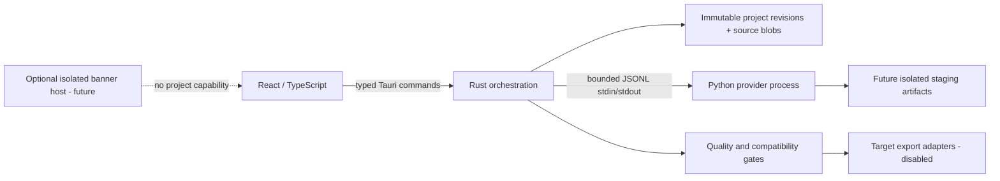

# Architecture — DEV-01

## 제품 경계
제작용 데스크톱 앱이다. 방송 중 추적·리깅 서버가 아니다. 사용자가 보유한 원화를 로컬에서 분석하고 수정 가능한 마스터를 만들며, 검증된 대상별 사본을 내보내는 것이 제품 목표다. DEV-00은 저장/IPC/더미 실행만 구현한다. 얼굴·전신 자동 리깅 엔진은 연구 단계다.

## 실행 구조

현재 신뢰 경계: UI는 경로·실행 명령을 선택할 수 없다. 원본 경로 권한은 Rust 파일 선택 창과 검증된 native OS drop에서만 얻는다. Worker에는 protocol/job_id/provider만 전달하며 파일 접근을 위임하지 않는다. Python `-I`로 사용자 모듈 경로 영향을 줄이고 `-B`로 설치 위치의 bytecode 쓰기를 막는다. 이것은 OS 보안 샌드박스가 아니다. 실제 외부 모델 코드는 DEV-03/29의 프로세스 권한 제한 후에만 도입한다.

## 22개 독립 모듈의 계약과 소유권
공개 계약은 `src/contracts.ts`, IPC의 현재 구현은 `src-tauri/src/model.rs`, JSON 스키마는 `schemas/`에 있다. 아래의 Planned 모듈은 이름만 있는 구현으로 취급하지 않는다.

| ID / 모듈 | 입력 → 출력; 변경 권한 | DEV-00 / 담당 DEV |
|---|---|---|
| M01 Desktop UI | 명령 DTO → 상태/번역 화면; 파일 직접 수정 금지 | 구현 / 00,25 |
| M02 Project Storage | 프로젝트 ID+예상 revision → 새 immutable revision | 구현 / 00,01 |
| M03 Source Asset Management | 사용자가 선택한 PNG → 원본 blob+SHA-256 | 제한 구현 / 00,02 |
| M04 AI Runtime Manager | ModelManifest+job → 상태 이벤트; 모델별 환경 | 더미 구현 / 00,03 |
| M05 GPU Capability Manager | 로컬 진단 → 장치/VRAM/지원 근거 | NVIDIA 감지, 추론 미검증 / 00,03 |
| M06 Image Analysis | 원본 참조 → 특징·영역·신뢰도 | Planned / 04 |
| M07 Layer Segmentation | 원본+mask → 원해상도 레이어 참조 | Planned / 05 |
| M08 Hidden Region Reconstruction | 가림 영역 → 생성 레이어+추정 표시 | Planned / 06 |
| M09 2D Auto-Rig | 레이어 그래프 → 메시·디포머 마스터 | Planned / 07–10 |
| M10 3D Generation | 원본/추정 view → 3D 중간 결과 | Planned / 12–14 |
| M11 3D Auto-Rig | 교정 메시 → 뼈대/가중치 후보 | Planned / 15–16 |
| M12 Facial Rig Solver | 표정 의미 계약 → 2D bindings/3D blendshapes | Planned / 09,17 |
| M13 Full-Body Rig Solver | 휴머노이드/보정 데이터 → 포즈·관절 보정 | Planned / 16,18 |
| M14 Physics Authoring | 신체·옷·머리+충돌체 → 물리 마스터 | Planned / 10,19 |
| M15 Quality Evaluation | 원본/결과/테스트 → Gate evidence | 상태 계약 / 00,20 |
| M16 Automatic Repair | 결함 위치 → 변경 제안+새 artifact | Planned / 21 |
| M17 Preview Renderer | 불변 마스터+포즈 → 비교 뷰 | Planned / 08,14,22 |
| M18 Export Profiles | 마스터+버전 고정 프로필 → 배포 사본+손실 보고 | 인터페이스, exporter 비활성 / 11,23 |
| M19 Compatibility Validation | export+대상 버전 → 정적/실행 결과 | 정적 매핑 테스트 / 00,24 |
| M20 Localization | message key+인수 → 지역화 문자열 | ja/en/ko 구현 / 00,26 |
| M21 Advertisement Adapter | locale+동의 → 배너 최대 1개 또는 null | offline adapter / 00,27 |
| M22 Diagnostic and Recovery | 오류 코드+허용 로그 → 복구 행동 | 제한 구현 / 00,28 |

## 저장 및 트랜잭션
`VTUBER_DATA_DIR/projects/<uuid>/`에 `00000001.json`, `00000002.json`과 `sources/<sha256>.png`를 저장한다. 개발 환경은 `scripts/env.ps1`이 E 작업 폴더의 `.tools/app-data`로 고정한다. 설정이 없으면 실행 파일 옆 `vtuber-data`를 사용한다. WebView2 캐시도 같은 데이터 루트에 둔다. 이름은 경로에 쓰지 않는다. 기존 원본은 읽기만 하고, 저장 시 디코딩 결과가 아니라 원래 bytes를 복사한다. PNG의 ICC/텍스트/감마/비트 깊이는 원본 blob에 보존된다. DEV-00에는 색 관리 미리보기가 없었다. DEV-02는 별도 RGB ICC 변환/미리보기를 제공하며 실제 디스플레이 색 충실도 인증은 미검증이다.

새 revision은 `.pending` 파일에 쓰고 `sync_all`, hard-link publish로 확정한다. 이미 있는 revision을 덮어쓰지 않는다. 미완료 pending은 읽기에서 제외한다. 최신 정식 revision이 손상된 경우 자동으로 성공한 것처럼 이전 상태를 열지 않고 오류를 낸다. DEV-01에서는 개별 손상 항목을 격리하고 사용자 선택으로 새 revision을 복구한다. 원본 checksum 불일치는 fail-closed다. NTFS에서 검증하고 hard-link 미지원 파일시스템은 저장 오류로 안내한다. 전원 차단, 디렉터리 엔트리 내구성, 다중 프로세스·네트워크 드라이브의 완전한 내구성은 보장하지 않는다.

DEV-01 SQLite는 프로젝트 검색·검사 상태의 재구축 인덱스에 사용한다. Job은 별도 journal 정본으로 관리한다. 원본/마스터의 유일한 정본은 파일이다. DB 유실 시 파일 스캔으로 재구축한다. 이 단계에서 DB와 파일을 동시에 정본으로 만드는 이중 커밋은 기각했다.

## 작업과 오류 격리
현재 상태 머신: idle → queued → running → completed/cancelled/failed, 재시작 시 interrupted/recovery_required. 앱당 한 작업, progress 단조 증가, JSONL 64KiB, 최대 1,000 이벤트, 20초 더미 제한. 취소/timeout/프로토콜 오류는 자식 종료·회수 후 최종 상태가 된다. 모델 생성 성공과 더미 완료는 별개다. 더미는 프로젝트와 Gate를 변경하지 않는다. 실행 종료 시 취소 신호를 보내며, 강제 앱 종료 시 OS job-object 기반 자식 트리 정리는 DEV-28의 미해결 항목이다.

실제 AI는 별도 모델 환경, 단계별 staging, 체크포인트, CUDA OOM 분류, 재시작, 선택적 재작업을 사용한다. 수락된 artifact만 코어가 검증하고 커밋한다. CPU 대안은 provider가 실제 검증한 기능에만 표시한다. NVIDIA 장치를 발견한 사실은 PyTorch/CUDA 지원 증거가 아니다.

## 교체·확장
UI는 provider 세부 코드를 import하지 않는다. Python 모델 어댑터는 버전 협상과 공통 artifact 계약을 구현한다. 2D와 3D는 서로의 메시를 강제로 공유하지 않고 `SemanticExpression`만 공유한다. exporter는 마스터를 수정하지 않으며 손실·최소 대상 버전·원본 hash를 보고한다. schema 변경은 별도 복사본 migration, rollback fixture와 구버전 읽기 테스트를 먼저 추가한다.

## DEV-01 구현 경계

M02는 storage.rs + durable.rs + recovery.rs + index.rs로 구분한다. 저장 API는 프로젝트 OS lock 아래에서 read/expected revision/write를 직렬화한다. 목록/검색/복구 IPC는 blocking pool에서 검사하며 v2 DTO가 정상/문제 항목을 분리한다. 구 list API는 정상 배열을 유지한다. M04는 worker.rs와 journal.rs로 실행과 내구 기록을 분리한다. 모델/Worker protocol과 CharacterProject v1은 유지한다.

정확한 디스크 구조·파일/DB 트랜잭션·실패 한계는 STORAGE_RECOVERY, job 재시작은 JOB_PERSISTENCE, schema 경계는 MIGRATION_STRATEGY가 정본이다. release에는 test-only fault hook이 포함되지 않는다.

## DEV-02 integration

M03 now contains image_input.rs (PNG/ICC/derived preview), psd_input.rs (checked borrowed PSD sections), source_input.rs (stable source capture/publication). Dialog and native OS drop are the only path authorities; UI drop command carries no pathname. A process-local single-entry preview cache is derived and source hash checked. Parsing runs in a blocking pool; cancellation uses an atomic flag. This is bounded CPU decoding, not a full OS sandbox. IMAGE_IMPORT/PSD_SUPPORT_MATRIX/COLOR_MANAGEMENT define exact limits.
